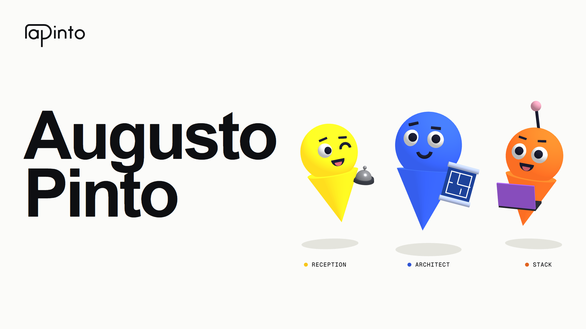
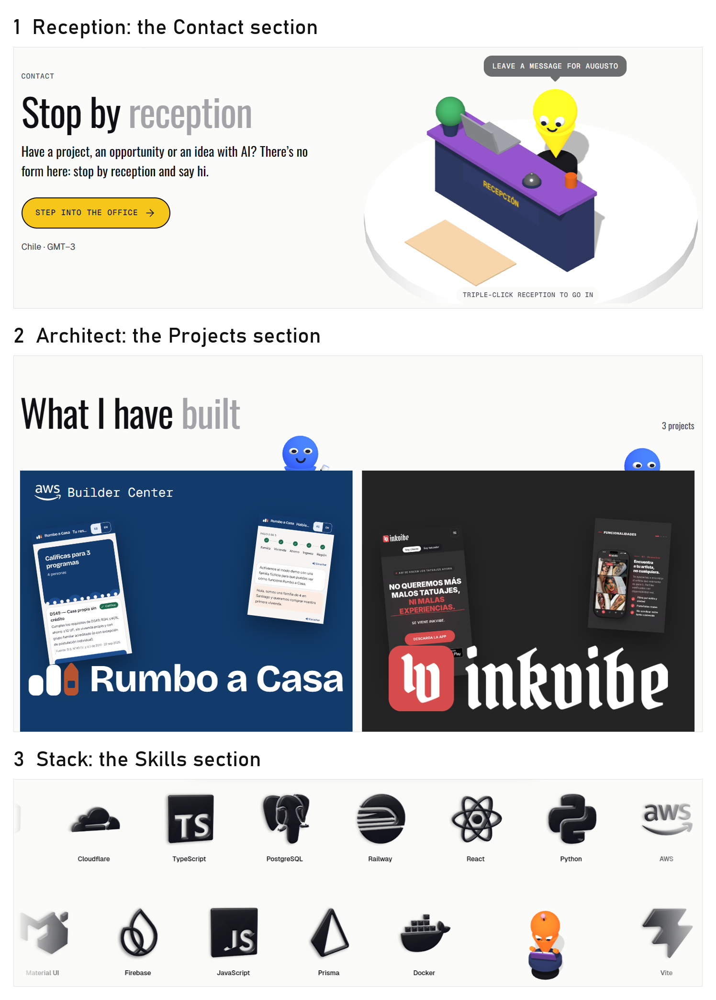
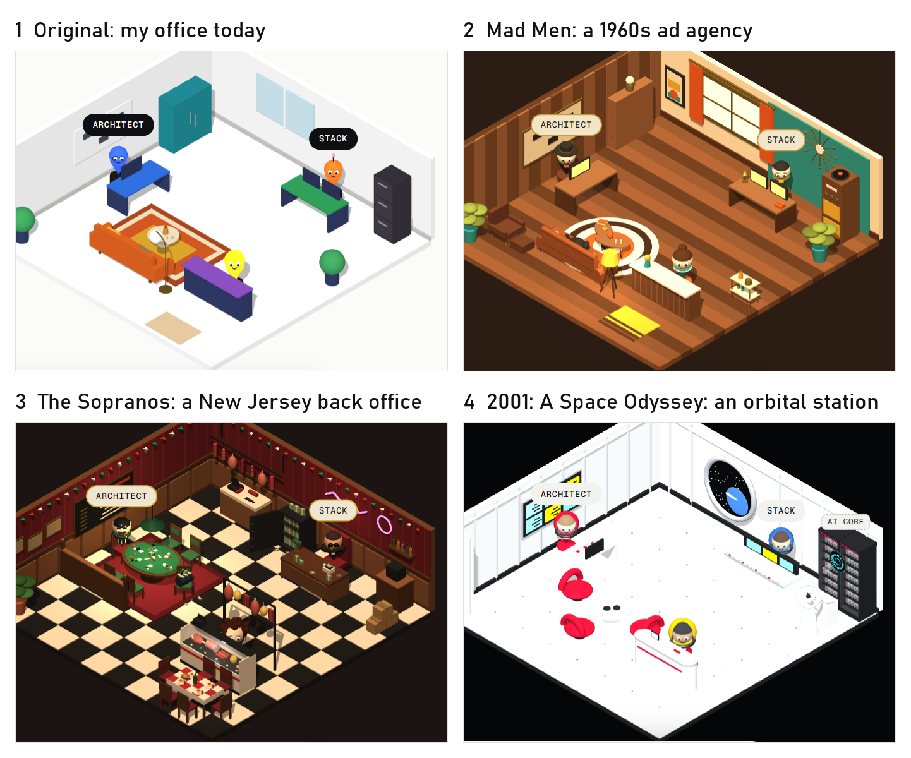
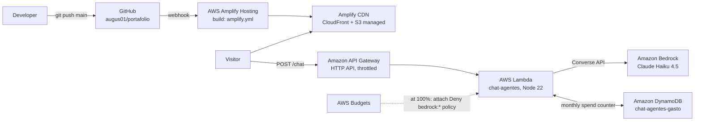

<p align="center">
  <picture>
    <source media="(prefers-color-scheme: dark)" srcset="docs/marca/apinto-oscuro.svg" />
    
  </picture>
</p>

<h1 align="center">Augusto Pinto · Portfolio</h1>

<p align="center"><em>Fewer promises, more products that help every day.</em></p>

<p align="center">
  <strong>A portfolio with an office instead of a contact form.</strong><br />
  About Me, Skills and Projects, plus a 3D office where three AI agents on Amazon Bedrock show you around, deployed on AWS Amplify Hosting.
</p>

<p align="center">
  <a href="https://main.d21d1ifzfdin9a.amplifyapp.com"><strong>Live site</strong></a> ·
  <a href="https://main.d21d1ifzfdin9a.amplifyapp.com/oficina/">Visit my office</a> ·
  <a href="https://github.com/augus01">GitHub @augus01</a>
</p>

<p align="center">
  
  
  
  
</p>

<p align="center">
  <a href="https://main.d21d1ifzfdin9a.amplifyapp.com"></a>
</p>

> **AWS Student Builder Challenge** · "Build Your Tech Superpower" · 2026

## About

I'm a 4th-year Computer Science Engineering student at Universidad San Sebastián in Santiago, Chile, and I'm working toward becoming an AI Engineer. I build products where AI solves a real situation for someone, not as a demo.

The site opens in English. You can switch to Chilean Spanish with the **EN | ES** toggle in the navigation bar.

## What's inside

| Section | Where | What it shows |
|---|---|---|
| **About Me** | `/#sobre-mi` | My story: how I went from frontend bootcamps to building full products with applied AI. |
| **Skills / Tech Superpowers** | `/#superpoderes` | Two moving rows with the 17 technologies I use. Hover over a row to pause it, then click a technology to see what I built with it. |
| **Projects / Achievements** | `/#proyectos` | Three case studies, each on its own page: **Rumbo a Casa** (co-creator; winner of AWS Zero to Shipped), **Inkvibe** (sole frontend developer) and **Zam** (my own project, still in development). |
| **Creative feature: "Visit my office"** | `/oficina/` | An interactive 3D model of my office with three AI agents you can chat with. |
| **Contact** | `/#contacto` | Reception. This is where the visible hint to the office lives. |

## The creative feature: "Visit my office"

Instead of a contact form, my portfolio has an office. It's a 3D model built with three.js. Each agent takes care of one part of my portfolio:

| Agent | Takes care of |
|---|---|
| **reception** | Who I am, plus taking a message for me |
| **architect** | My projects and how they're built |
| **stack** | The technologies I use and what I did with each one |

Each agent also lives in its section of the landing page:

<p align="center">
  
</p>

When you ask the wrong agent, it hands the conversation to the right one. You can also restyle the office as one of three TV and film settings: *Mad Men*, *The Sopranos* or *2001: A Space Odyssey*.

<p align="center">
  
</p>

**How to find it.** The Contact section has a visible hint, **"Step into the office"**, plus a reception character you can double-click to go in. The office also has a link in the footer and in the Skills and Projects sections ("Continue with stack in the office").

**Why it reflects me.** The office applies the way I build products to my own portfolio: instead of reading about me, you ask the agents.

## The design decision that matters

The creative feature must never get in the way of the portfolio. So **the AI is optional and the portfolio never depends on it**:

- The office lives on its own page. The portfolio loads and works without it.
- three.js loads lazily, only when you open the office.
- If WebGL isn't available, a text fallback appears and you can still chat with the office.
- If the AI API is down, slow (8 s timeout) or not configured, a rule-based chat answers instead, with the same agents and the same handoffs. The chat never breaks.
- The agents' knowledge comes from one place: `src/content/office.js` and `src/content/en/office.js`. `scripts/chat-agentes-contenido.mjs` turns them into `infra/lambda/contenido.json`, so the AI and the rule-based fallback always say the same thing.
- It works on mobile and respects `prefers-reduced-motion`.

## Architecture



| Service | Role |
|---|---|
| **AWS Amplify Hosting** | Hosts the static site, with CI/CD from GitHub. Every push to `main` builds and deploys automatically (see `amplify.yml`). It serves the site over HTTPS from Amplify's managed CDN (CloudFront + S3). |
| **Amazon API Gateway (HTTP API)** | Public `POST /chat` endpoint. CORS only allows the site's origin, and requests are throttled to 2 per second with a burst of 5. |
| **AWS Lambda** | `chat-agentes` (Node.js 22, 256 MB, 10 s timeout). It validates the request, builds the agent's prompt from the site content, calls Bedrock and enforces the spending cap. |
| **Amazon Bedrock** | Claude Haiku 4.5 through a tagged application inference profile (`chat-agentes-haiku`), so its cost can be tracked separately. |
| **Amazon DynamoDB** | `chat-agentes-gasto`, an on-demand table that tracks how much the chat has spent this month. Lambda stops calling Bedrock once it reaches its internal cap. |
| **AWS Budgets + IAM** | A monthly budget for the chat. At 100%, a budget action attaches a policy that denies `bedrock:*` to the Lambda role. This is a hard stop that doesn't depend on the code. |
| **AWS CloudFormation** | The whole chat backend is defined as code in `infra/chat-agentes.yaml`. |
| **Amazon CloudWatch Logs** | Lambda logs, kept for 7 days. |

### Cost guardrails

Three independent layers protect the chat: API Gateway throttling, an in-code spending counter in DynamoDB, and the Budgets action that denies Bedrock access at the IAM level. All resources carry the tags `project=portafolio` and `componente=chat-agentes`, so their cost can be broken down in Billing.

### Routing without rewrite rules

The office (`/oficina/`) and each case study (`/proyectos/<slug>/`) are real files. After the build, a small Vite plugin copies `index.html` into each route, so Amplify serves them directly and deep links never return 404.

## Tech stack

- **React 19 + Vite 8**, with no starter template
- **three.js 0.128** for the 3D office (lazy-loaded)
- **GSAP 3.13 (ScrollTrigger)** and **Lenis 1.3** for scroll and animation
- **Node's built-in test runner** for tests (no extra dependencies)
- An in-house design system ("Augusto Pinto" v8) in `design-system/`: tokens, `.ap-*` classes and monochrome typography

Dependency versions are pinned.

## Repository layout

```
src/
  components/          Atomic Design
    atoms/             Icon, Logo, Pill, LangSwitch, HeroCanvas, AgentFigure…
    molecules/         NavBar, SkillCard, ProjectTile, OfficeAgentCard…
    organisms/         Hero, AboutSection, SkillsSection, ProjectsSection, Office, OfficeChatDock…
    templates/         ImmersiveLandingTemplate, CasePageTemplate, OfficePageTemplate
    pages/             HomePage, ProjectPage, OfficePage
  content/             Spanish copy (*.js) and English copy (en/*.js), with the same shape
  hooks/               UI logic (useOfficeChat, useOfficeScene, useLang…)
  lib/                 Non-visual logic (officeChat rules, chat API client, 3D engine, language)
infra/
  chat-agentes.yaml    CloudFormation template for the chat backend
  lambda/              Lambda handler, its pure core (nucleo.mjs) and the agents' content
scripts/               Content generation for the Lambda, deploy and cost check
design-system/         Official visual system (tokens, components, rules)
docs/                  README images and brand assets
amplify.yml            Amplify build specification
```

## Run it

Requirements: Node.js 22.

```bash
npm install
npm run dev       # http://localhost:5173
npm run build     # production build in dist/
npm run preview   # serve the build at http://localhost:4173
npm test          # 156 tests: content parity EN/ES, chat rules, API client, Lambda core
```

The AI chat is optional. To use it locally, create `.env.local` with:

```
VITE_CHAT_API_URL=<your API Gateway URL>/chat
```

Without this variable, the office still works and answers with the built-in rule-based chat.

## Deploy

- **Frontend:** push to `main`. Amplify runs `npm ci` and `npm run build` with Node 22, then publishes `dist/`. `VITE_CHAT_API_URL` is set as an environment variable in the Amplify console.
- **Chat backend:** `bash scripts/desplegar-chat-agentes.sh` regenerates the agents' content, packages the Lambda and deploys the CloudFormation stack in `us-east-1`. To check current spend, run `bash scripts/revisar-costos.sh`.

## Accessibility and quality

- Responsive from 320 px, with touch targets of at least 44 px
- Full keyboard navigation with visible focus; dialogs and menus have labels for screen readers
- Respects `prefers-reduced-motion`
- `<html lang>` follows the selected language, and the choice is remembered
- Both languages are kept in sync by tests: every English content file must have the same exports and shape as the Spanish one

## Author

**Augusto Pinto** · Santiago, Chile · [GitHub @augus01](https://github.com/augus01)

Built for the AWS Student Builder Challenge, 2026.
